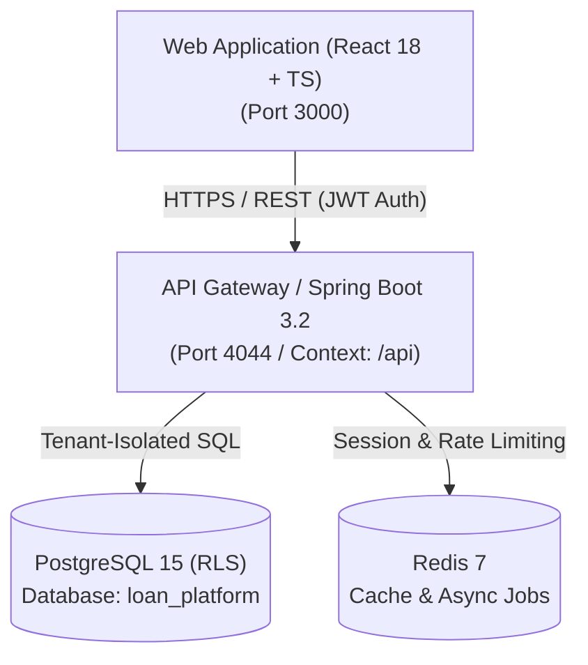

# LoanPlatform - Multi-Tenant Loan Management System (LLMS)
## System Overview & Architecture Specification

---

## 1. Executive Summary
**LoanPlatform** is an enterprise-grade multi-tenant Software-as-a-Service (SaaS) loan management platform designed for microfinance institutions, NBFCs, private financiers, and peer-to-peer (P2P) lending operators.

The platform provides end-to-end loan lifecycle management—from borrower onboarding and KYC verification to automated loan origination, multi-type interest calculations, installment scheduling, payment waterfall allocation, delinquency tracking, and double-entry accounting.

---

## 2. User Roles & Access Hierarchy

The system enforces strict Role-Based Access Control (RBAC) across tenants:

| Role | Scope | Key Capabilities | Default Test Credentials |
| :--- | :--- | :--- | :--- |
| **`SUPER_ADMIN`** | System-Wide | Tenant onboarding, subscription plan limits, system audits, global oversight | `admin@loanplatform.com` / `admin123` |
| **`LENDER_ADMIN`** | Tenant | Full operational control: onboard borrowers, create loans, disburse funds, log payments, view reports | Configurable per tenant |
| **`LENDER_STAFF`** | Tenant | Day-to-day operations: data entry, payment logging, customer support | Restricted operational |
| **`BORROWER`** | Individual | Read-only access to loan statements, repayment schedules, and receipts | Future portal |

---

## 3. Application Route Map (Frontend)

The application provides a responsive React 18 single-page application with the following core routes:

* **Authentication**:
  * `/login` — Secure sign-in page with email/password validation and role-based redirection
* **Main Dashboard**:
  * `/dashboard` — Portfolio summary cards (total disbursed, outstanding balance, active loans, collections)
* **Borrower Management**:
  * `/borrowers` — Searchable, paginated borrower table with status filters
  * `/borrowers/new` — Comprehensive borrower onboarding form with KYC and employment verification
  * `/borrowers/:id` — Detailed borrower profile with credit risk score and active loan history
* **Loan Management**:
  * `/loans` — Master loan registry with status badges (`DRAFT`, `PENDING_APPROVAL`, `APPROVED`, `ACTIVE`, `CLOSED`)
  * `/loans/new` — Loan origination form with real-time interest and EMI calculation
  * `/loans/:id` — In-depth loan view with repayment schedule table, status history, and disbursement actions
* **Payment Processing**:
  * `/payments` — Transaction ledger with allocation breakdown
  * `/payments/new` — Repayment recording modal enforcing the waterfall allocation engine
* **Reports & Analytics**:
  * `/reports` — Collections summary, portfolio risk distribution, and delinquency reports
