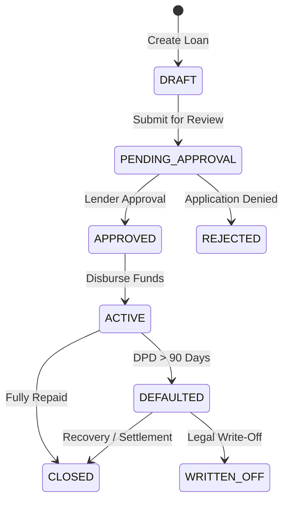
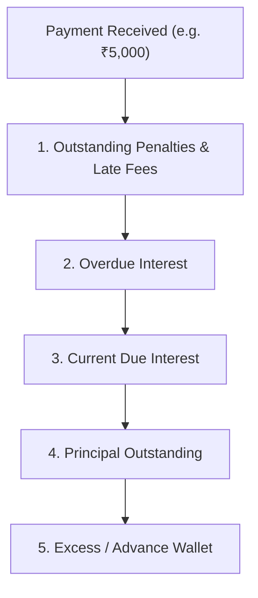

# LoanPlatform - Core Lending Lifecycle & Business Specifications

---

## 1. Borrower Onboarding & Risk Profiling

### Borrower Fields & Validations
* **Full Name**: Required, 2-100 characters.
* **Phone Number**: Required, unique per tenant, 10-digit standard format.
* **Email Address**: Optional, valid email syntax.
* **Identity Documents (KYC)**: National ID (Aadhaar/PAN/SSN), Passport, Voter ID.
* **Employment & Income**: Monthly gross income, employer name, occupation type.
* **Internal Risk Scoring**:
  * **Score Range**: 300 to 900
  * **Risk Bands**:
    * `LOW` (750+): Eligible for prime interest rates and maximum tenure.
    * `MEDIUM` (600–749): Standard lending terms; collateral recommended for high amounts.
    * `HIGH` (<600): Restricted loan sizes; requires guarantor or upfront security.
* **Lifecycle Statuses**: `ACTIVE`, `BLOCKED`, `BLACKLISTED`, `INACTIVE`.

---

## 2. Loan Origination & Interest Calculation Engine

### Supported Interest Calculation Types
| Interest Type | Formula / Mechanism | Usage Profile |
| :--- | :--- | :--- |
| **`FLAT`** | Interest is calculated on the original principal for the entire tenure: `Total Interest = P * R * T`. EMI is constant. | Informal lending, short-term microloans |
| **`REDUCING_BALANCE`** | Standard amortization (Reducing Balance): Interest calculated monthly on outstanding principal. | Traditional personal / business loans |
| **`SIMPLE`** | Simple interest: `Interest = (P * R * T) / 100`. | Short-term bridge loans |
| **`INTEREST_ONLY`** | Borrower pays monthly interest only; entire principal is repaid at maturity. | Working capital / real estate bridge |
| **`BULLET`** | Single lump-sum payment of principal + interest at tenure end. | Harvest / seasonal agricultural loans |
| **`DAILY_FIXED`** | Fixed monetary charge per ₹100 of principal per day. | Daily collection micro-credit |

### Loan Lifecycle State Machine

---

## 3. Repayment Waterfall Allocation Engine

When a borrower makes a payment, the system enforces a strict regulatory waterfall allocation order:

### Auto-Closure Rule
When `Total Outstanding Principal == 0` and `Outstanding Interest == 0` and `Outstanding Penalties == 0`, the loan status automatically transitions from `ACTIVE` &rarr; `CLOSED`.
