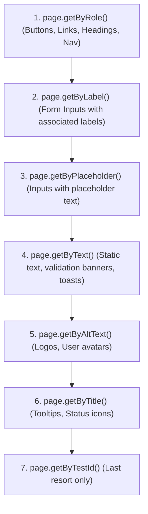

# LoanPlatform - QA Engineering Standards & Test Data Playbook

---

## 1. Test Environment & Base Configurations

* **Application URL**: `http://localhost:3000`
* **API Gateway URL**: `http://localhost:4044/api`
* **Test Runner Framework**: Playwright + TypeScript + Cucumber BDD
* **Browser Mode**: Headed by default (`headless: false` in `hooks.ts`) for visual demo narration.

### Standard Test Fixtures & Seed Accounts
| Role | Email | Password | Intended Test Usage |
| :--- | :--- | :--- | :--- |
| **`SUPER_ADMIN`** | `admin@loanplatform.com` | `admin123` | Platform oversight, tenant onboarding validation, global reports |
| **`LENDER_ADMIN`** | `kpraveen@gmail.com` | `admin123` | Borrower creation, loan origination, payment processing |

---

## 2. Playwright Semantic Locator Priority (7-Level Hierarchy)

The AI QA Agent adheres strictly to Playwright's official locator priority. **Semantic, accessibility-driven locators are always prioritized over technical selectors:**



### Locator Examples in LoanPlatform POM:
```typescript
// Priority 1: Semantic Role
readonly signInButton = this.page.getByRole('button', { name: 'Sign in' });
readonly addBorrowerButton = this.page.getByRole('button', { name: 'Add Borrower' });

// Priority 2: Accessible Form Label
readonly emailInput = this.page.getByLabel('Email address');
readonly passwordInput = this.page.getByLabel('Password');
readonly borrowerNameInput = this.page.getByLabel('Full Name');

// Priority 4: Message / Alert Text
readonly errorBanner = this.page.getByText('Invalid email or password');
```

---

## 3. BDD Scenario Formatting Standards

Every Gherkin feature file must:
1. Be tagged with the corresponding Azure DevOps Work Item tag (e.g. `@ADO-4` or `@ADO-5`).
2. Express steps in clear business outcomes:
   * **`Given`**: User state and initial navigation.
   * **`When`**: User actions (entering credentials, clicking buttons, submitting forms).
   * **`Then`**: Verifiable assertions (URL change, visible welcome toast, updated table count).
