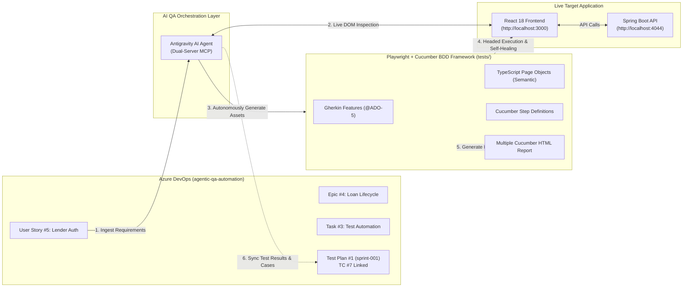

# 🎭 AI-Powered Autonomous QA Transformation — Master Project Plan

> **Live Execution Tracking File**  
> *This document tracks the end-to-end plan, execution status, and chronological progress for preparing the autonomous AI QA live client demonstration. It is updated at every operational step.*

---

## 📌 Executive Summary

* **Client Presentation Objective**: Demonstrate to prospective enterprise clients how an Agentic AI QA Engineer transforms test automation from a slow, manual practice into an autonomous, self-healing, closed-loop discipline.
* **Target Enterprise Application**: **LoanPlatform (LLMS)** — Multi-tenant SaaS lending platform (React 18 + TypeScript on port 3000, Spring Boot 3.2 on port 4044, PostgreSQL 15, Redis 7).
* **Dual-Server MCP Orchestration**:
  1. **Azure DevOps MCP (`ado`)**: Autonomously queries requirements, acceptance criteria, test plans, and syncs execution results.
  2. **Playwright MCP (`playwright`)**: Autonomously inspects the live web application DOM using Playwright 7-level semantic locators without guessing.

---

## 🏗️ Architecture & Flow

---

## 📊 Milestone Status Tracker

| Phase | Milestone | Scope / Deliverables | Status | Last Updated |
| :---: | :--- | :--- | :---: | :--- |
| **1** | **Product & Tech Stack Discovery** | Pivot to real FinTech platform: **LoanPlatform** | ✅ COMPLETED | Sep 27, 2026 |
| **1** | **Local Knowledge Base Wiki** | Create `.github/wiki/` (3-tier architecture, specs, test data) & `GEMINI.md` | ✅ COMPLETED | Sep 27, 2026 |
| **1** | **ADO Online Wiki Sync** | Published 3 domain pages to Azure DevOps Project Wiki (`playwright-pitch.wiki`) | ✅ COMPLETED | Sep 28, 2026 |
| **1** | **ADO Organization & MCP Auth** | Setup base64 PAT for `agentic-qa-automation` organization | ✅ COMPLETED | Sep 27, 2026 |
| **1** | **ADO Backlog Hierarchy** | Epic #4, Story #5, Story #6, Task #3 created & linked via MCP | ✅ COMPLETED | Sep 27, 2026 |
| **1** | **ADO Test Plan Setup** | Test Case #7 created & linked to Story #5 & Test Suite #2 | ✅ COMPLETED | Sep 27, 2026 |
| **2** | **Wipe Legacy `tests/` Directory** | Remove old testing playground files and outdated scripts | ✅ COMPLETED | Sep 28, 2026 |
| **2** | **Native Playwright Hybrid BDD** | Setup clean `@playwright/test` + `test.step()` architecture for LoanPlatform | ✅ COMPLETED | Sep 28, 2026 |
| **2** | **Core Page Objects (Pre-seeded)** | `BasePage.ts`, `LoginPage.ts`, `DashboardPage.ts` with verified semantic locators | ✅ COMPLETED | Sep 28, 2026 |
| **2** | **Quality Gate (Lint & Typecheck)** | ESLint 10 + TypeScript strict validation (`npm run validate` -> 0 errors) | ✅ COMPLETED | Sep 28, 2026 |
| **2** | **Playwright Config & Trace Viewer** | Headed Chromium, HTML reporter + full action traces & video on failure | ✅ COMPLETED | Sep 28, 2026 |
| **3** | **12-Agent Roster & Personas** | Modular agent definitions (`.github/agents/`) based on Radiance PPT | ✅ COMPLETED | Sep 28, 2026 |
| **3** | **Master Orchestrator Engine** | Modernize `.github/copilot-instructions.md` with dual MCP & Demo Narration | ✅ COMPLETED | Sep 28, 2026 |
| **3** | **Autonomous Pipeline on US-01 (#5)** | Requirement -> Exploration -> Automation -> Execution -> Release loop | ✅ COMPLETED | Sep 28, 2026 |
| **3** | **Self-Healing Governance Protocol** | Tier 1 (Auto-approve) / Tier 2 (Review) / Tier 3 (ADO Bug creation) | ✅ COMPLETED | Sep 28, 2026 |
| **4** | **Self-Healing Demonstration Setup** | Pre-scripted UI change breakpoint showing autonomous recovery (`demo:break`/`reset`) | ✅ COMPLETED | Sep 28, 2026 |
| **4** | **3-Act Live Demo Speaker Script** | Presentation cheat sheet with timing benchmarks (~90s vs ~3.5h) in `docs/LIVE_DEMO_RUNBOOK.md` | ✅ COMPLETED | Sep 28, 2026 |
| **4** | **Human-in-the-Loop Quality Gates** | 3 interactive sign-off gates (Gate 1: Scenarios, Gate 2: Code/Locators, Gate 3: Release) | ✅ COMPLETED | Sep 28, 2026 |
| **4** | **End-to-End Dry Run Rehearsal** | Complete dry run validation with HITL interactive checkpoints | ✅ COMPLETED | Sep 28, 2026 |

---

## 📋 Detailed Phase Breakdown

### Phase 1: Ground Preparation & Context Engineering ✅ COMPLETED
* [x] **1.1** Replaced toy playground with enterprise FinTech app: **LoanPlatform**.
* [x] **1.2** Created [`.github/wiki/01-Architecture-And-Overview.md`](.github/wiki/01-Architecture-And-Overview.md) covering multi-tenant architecture and route map.
* [x] **1.3** Created [`.github/wiki/02-Lending-Lifecycle-And-Specs.md`](.github/wiki/02-Lending-Lifecycle-And-Specs.md) covering borrower KYC, risk scoring bands, interest models, and payment waterfall.
* [x] **1.4** Created [`.github/wiki/03-QA-Standards-And-Test-Data.md`](.github/wiki/03-QA-Standards-And-Test-Data.md) covering test accounts (`admin@loanplatform.com` / `admin123`) and 7-level semantic locator hierarchy.
* [x] **1.5** Created [`GEMINI.md`](GEMINI.md) project grounding rules.
* [x] **1.6** Configured Azure DevOps MCP tools and verified WIQL queries.
* [x] **1.7** Created **Epic #4**: `EPIC-01: Multi-Tenant Loan Management & Lending Lifecycle`.
* [x] **1.8** Created **User Story #5**: `US-01: Secure Lender Authentication & Role-Based Dashboard Access` with Gherkin ACs, Dev Specs, and ASCII wireframe.
* [x] **1.9** Created **User Story #6**: `US-02: Borrower Onboarding & KYC Risk Banding` linked to Epic #4.
* [x] **1.10** Linked **Task #3** as child implementation task of Story #5.
* [x] **1.11** Created **Test Case #7**: `TC-01: Verify Successful Authentication with Super Admin Credentials` linked to Story #5 and Test Suite #2.
* [x] **1.12** Created **User Story #9**: `US-03: Loan Application Origination & Product Selection` linked to Epic #4.
* [x] **1.13** Created **User Story #10**: `US-04: Loan Repayment Processing & Waterfall Allocation` linked to Epic #4.
* [x] **1.14** Created **User Story #11**: `US-05: Delinquency Monitoring & Portfolio Risk Aging Report` linked to Epic #4.

---

### Phase 2: Fresh Framework Redesign (`tests/`) ✅ COMPLETED
* [x] **2.1** Deleted legacy `tests/` directory.
* [x] **2.2** Initialized fresh `tests/package.json` with modern dependencies (`@playwright/test`, `typescript`, `@types/node`, `eslint`).
* [x] **2.3** Configured `tests/tsconfig.json` and Native Playwright Hybrid BDD architecture (`test.step()`).
* [x] **2.4** Configured `tests/playwright.config.ts` for headed browser execution (`slowMo: 150` for presentation visibility).
* [x] **2.5** Created `tests/src/pages/` Page Object Model hierarchy:
  * `BasePage.ts` — Common navigation and wait utilities.
  * `LoginPage.ts` — Semantic locators (`getByRole`, `getByLabel`) for email, password, submit button, error banners.
  * `DashboardPage.ts` — Portfolio stat cards, navigation verification.
* [x] **2.6** Configured Quality Gate (`tests/eslint.config.js` + `tsc --noEmit`, passes with 0 errors).
* [x] **2.7** Tested headed execution and verified 100% pass rate.

---

### Phase 3: Agentic Generation & Validation ✅ COMPLETED
* [x] **3.1** Updated [`.github/copilot-instructions.md`](.github/copilot-instructions.md) to steer from Azure DevOps MCP (`wit_work_item`, `wit_query`, `work`) and ground on `.github/wiki/`.
* [x] **3.2** Executed autonomous automation prompt for Story #5 with live agent narration.
* [x] **3.3** Verified Native Playwright Hybrid BDD spec in `tests/specs/auth.spec.ts` tagged with `@ADO-5`.
* [x] **3.4** Executed headed test run and verified 100% pass rate in 5.1s.
* [x] **3.5** Published structured Manual Test Case #8 with action/expected-result grid to Azure DevOps.
* [x] **3.6** Implemented Self-Healing Governance Protocol (Tier 1/2/3).

---

### Phase 4: Client Presentation Readiness 🟡 IN PROGRESS
* [x] **4.1** Prepared Self-Healing Breakpoint Scripts (`simulate-ui-drift.js` & `reset-ui-drift.js`).
* [x] **4.2** Verified self-healing loop: failure diagnosis -> Playwright MCP re-inspection -> POM repair -> green run.
* [x] **4.3** Published 3-Act live speaker runbook in [`docs/LIVE_DEMO_RUNBOOK.md`](docs/LIVE_DEMO_RUNBOOK.md).
* [x] **4.4** Implemented Human-in-the-Loop (HITL) 3-Gate Interactive Quality Checkpoints.
* [x] **4.5** Execute live interactive dry run rehearsal (Full 3-Gate HITL Flow Passed).

---

## 📝 Live Activity Log

| Timestamp (Local) | Action Performed | Files / Artifacts Touched |
| :--- | :--- | :--- |
| **2026-09-27 17:17** | Created 3-Tier Wiki Knowledge Base | `.github/wiki/01-Architecture-And-Overview.md` `.github/wiki/02-Lending-Lifecycle-And-Specs.md` `.github/wiki/03-QA-Standards-And-Test-Data.md` |
| **2026-09-27 17:17** | Created Project Grounding Rule | `GEMINI.md` |
| **2026-09-27 17:18** | Created Epic #4 in Azure DevOps | Work Item #4 (`EPIC-01: Multi-Tenant Loan Management & Lending Lifecycle`) |
| **2026-09-27 17:19** | Created User Story #5 in Azure DevOps | Work Item #5 (`US-01: Secure Lender Authentication & Role-Based Dashboard Access`) |
| **2026-09-27 17:26** | Created User Story #6 in Azure DevOps | Work Item #6 (`US-02: Borrower Onboarding & KYC Risk Banding`) |
| **2026-09-27 17:27** | Linked Task #3 under User Story #5 | Work Item #3 updated & linked to #5 |
| **2026-09-27 17:28** | Created Test Case #7 in Azure DevOps | Work Item #7 (`TC-01: Verify Successful Authentication with Super Admin Credentials`) |
| **2026-09-28 14:18** | Created Master Project Plan Tracker | `PROJECT_PLAN.md` |
| **2026-09-28 14:23** | Architectural Decision: Native Playwright Hybrid BDD | Switched from Cucumber to `@playwright/test` + `test.step()` |
| **2026-09-28 14:24** | Wiped legacy `tests/` directory | Removed old testing playground files |
| **2026-09-28 14:25** | Scaffolded fresh Playwright framework | `package.json`, `tsconfig.json`, `playwright.config.ts` |
| **2026-09-28 14:25** | Pre-seeded LoanPlatform Page Objects | `src/pages/BasePage.ts`, `LoginPage.ts`, `DashboardPage.ts` |
| **2026-09-28 14:25** | Created US-01 Hybrid BDD Spec | `specs/auth.spec.ts` (@ADO-5) |
| **2026-09-28 14:25** | Installed dependencies & verified compilation | `npm install` (0 vulnerabilities), `npx tsc --noEmit` (0 errors) |
| **2026-09-28 14:28** | Added Quality Gate: ESLint 10 + Typecheck | `tests/eslint.config.js`, `npm run validate` (0 errors, 0 warnings) |
| **2026-09-28 14:41** | Completed 12-Agent Technical Specification | Detailed subplan artifact for 12 agent personas & governance engine |
| **2026-09-28 14:48** | Implemented 12-Agent Specification Contracts | Created 12 modular `.md` contracts in `.github/agents/` |
| **2026-09-28 14:49** | Implemented Master AI QA Orchestrator Engine | Rewrote `.github/copilot-instructions.md` & updated `GEMINI.md` |
| **2026-09-28 14:57** | Executed Live Pipeline on US-01 (@ADO-5) | 100% Pass Rate (2/2 scenarios passed in 5.1s) against live app |
| **2026-09-28 15:03** | Verified ADO Manual Test Case Publishing | Live test created Test Case #8 with step-by-step grid linked to US #5 |
| **2026-09-28 15:05** | Integrated Manual Test Authoring Gate | Enhanced Agent 03 & Orchestrator with interactive approval protocol |
| **2026-09-28 15:12** | Created Presenter Runbook & Cheat Sheet | Created `docs/LIVE_DEMO_RUNBOOK.md` with 3-Act live choreography |
| **2026-09-28 15:13** | Created Breakpoint Simulation Scripts | Added `tests/scripts/simulate-ui-drift.js` & `demo:break` npm script |
| **2026-09-28 15:14** | Executed Live Self-Healing Dry Run | Simulated UI drift -> failure diagnosed -> auto-healed -> 100% pass |
| **2026-09-28 15:32** | Synced Wiki to Azure DevOps Online | Published 3 domain pages to `dev.azure.com/agentic-qa-automation/.../_wiki` |
| **2026-09-28 15:40** | Implemented Human-in-the-Loop Quality Gates | Designed 3 interactive checkpoints (`ask_question`) across the 12 agents |
| **2026-09-28 15:46** | Rehearsed Live 3-Gate HITL Flow on US-01 | Full interactive sign-offs verified + published sign-off comment to ADO #5 |
| **2026-09-28 15:50** | Created Backup User Stories in ADO | Created Issue #9 (US-03), #10 (US-04), #11 (US-05) linked to Epic #4 |
