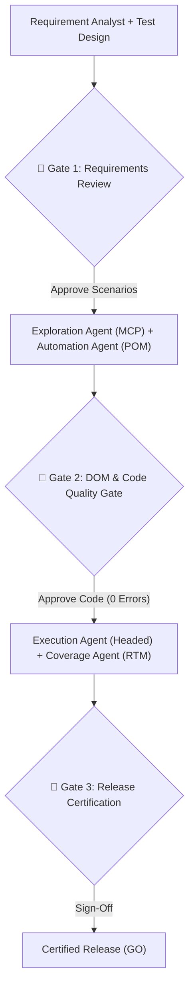

# 🏦 LoanPlatform — Autonomous AI QA Orchestrator
## Enterprise-Grade Continuous Quality Engineering & Governed Self-Healing

[](https://github.com/kurra-praveen/jira-to-playwright-agent/actions/workflows/playwright.yml)
[](https://www.typescriptlang.org/)
[](https://playwright.dev/)
[](https://dev.azure.com/)

---

### 🌟 Executive Overview

This repository houses the **Master AI QA Orchestration Framework** for **LoanPlatform** — an enterprise multi-tenant loan management SaaS system.

Modeled on the **Radiance Continuous Test Lifecycle & Governance Protocol**, this system coordinates **12 specialized Quality Engineering agents** operating across four continuous quadrants, enforcing **Human-in-the-Loop (HITL) quality gates** to eliminate black-box AI risk.

```
┌─────────────────────────────────┬─────────────────────────────────┐
│     1. UNDERSTAND & PLAN        │        2. BUILD & RUN           │
├─────────────────────────────────┼─────────────────────────────────┤
│ • 01. Requirement Analyst       │ • 04. Exploration Agent (MCP)   │
│ • 02. Test Strategy Agent       │ • 05. Automation Agent (POM)    │
│ • 03. Test Design Agent         │ • 06. Execution Agent (Runner)  │
├─────────────────────────────────┼─────────────────────────────────┤
│     3. DIAGNOSE & REPAIR        │       4. IMPROVE & DECIDE       │
├─────────────────────────────────┼─────────────────────────────────┤
│ • 07. Failure Intelligence      │ • 10. Coverage Agent (RTM)      │
│ • 08. RCA Agent (Root Cause)    │ • 11. Defect Agent (ADO Bugs)   │
│ • 09. Healer Agent (Governance) │ • 12. Release Quality Agent     │
└─────────────────────────────────┴─────────────────────────────────┘
```

---

### 🚦 The 3 Human-in-the-Loop Governance Gates

To eliminate black-box AI risks, the Orchestrator pauses at three verifiable checkpoints with full evidence on screen:



1. **Gate 1: Requirements & Test Scenario Review**  
   Presents extracted Gherkin `test.step()` scenarios matching `@ADO-<id>` for QA approval before writing code.
2. **Gate 2: DOM Locators & Code Quality Gate**  
   Extracts Playwright 7-level semantic locators from the live DOM and proves `npm run validate` passes with 0 errors.
3. **Gate 3: Release Certification & Trace Review**  
   Presents live execution results, 100% Requirements Traceability Matrix (RTM), and the executive Release Readiness Scorecard.

---

### 🛠️ Dual-Server MCP Protocol

1. **Azure DevOps MCP (`ado`)**: Autonomously retrieves User Stories, Epics, and Acceptance Criteria, authors structured manual Test Cases linked to Stories, and logs defects.
2. **Playwright MCP (`playwright`)**: Connects directly to the live running application at `http://localhost:3000` to inspect the accessibility tree and extract resilient semantic locators (`getByRole`, `getByLabel`, `getByPlaceholder`).

---

### 📁 Repository Structure

```
jira-to-playwright-agent/
├── .github/
│   ├── agents/                   # 12 Autonomous QA Agent role contracts
│   ├── wiki/                     # LoanPlatform Domain Knowledge Base
│   │   ├── 01-Architecture-And-Overview.md
│   │   ├── 02-Lending-Lifecycle-And-Specs.md
│   │   └── 03-QA-Standards-And-Test-Data.md
│   ├── workflows/
│   │   └── playwright.yml        # CI test pipeline
│   └── copilot-instructions.md   # Master Orchestrator engine & governance rules
├── .vscode/
│   └── mcp.json                  # Dual-server MCP configuration (ADO + Playwright)
├── docs/
│   ├── setup-guide.md            # Environment setup and execution guide
│   ├── LIVE_DEMO_RUNBOOK.md      # 3-minute executive client demo script
│   └── prompt-templates.md       # Pre-configured prompt templates
├── tests/
│   ├── specs/                    # Playwright test specs (@ADO-5, @ADO-6)
│   ├── src/
│   │   └── pages/                # Strongly-typed Page Objects extending BasePage
│   ├── scripts/
│   │   ├── simulate-ui-drift.js  # Intentional UI drift simulator for self-healing demo
│   │   └── reset-ui-drift.js     # Reset script
│   ├── playwright.config.ts      # Multi-browser headed/headless demo configuration
│   └── package.json              # Test framework dependencies & scripts
├── GEMINI.md                     # Agent guidance & anti-deviation guardrails
├── package.json                  # Root delegating convenience scripts
└── README.md
```

---

### 🚀 Quickstart & Commands

All commands can be run directly from the repository root:

| Command | Description |
| :--- | :--- |
| `npm run validate` | TypeScript compilation check + ESLint quality gate (**0 errors**). |
| `npm run test:demo` | Run tests in visible headed Chromium with `slowMo: 150ms` for live presentations. |
| `npm run test` | Run headless test suite for CI execution. |
| `npm run report` | Launch interactive Playwright HTML report and Trace Viewer. |
| `npm run demo:break` | Simulate breaking UI change (altering button text in `LoginPage.ts`). |
| `npm run demo:reset` | Reset simulated UI change back to baseline. |

---

### 🔑 Test Credentials (LoanPlatform)

| Role | Email | Password | Scope |
| :--- | :--- | :--- | :--- |
| **`SUPER_ADMIN`** | `admin@loanplatform.com` | `admin123` | Platform oversight, system audits, global settings |
| **`LENDER_ADMIN`** | `kpraveen@gmail.com` | `admin123` | Borrower onboarding, loan origination, repayments |
